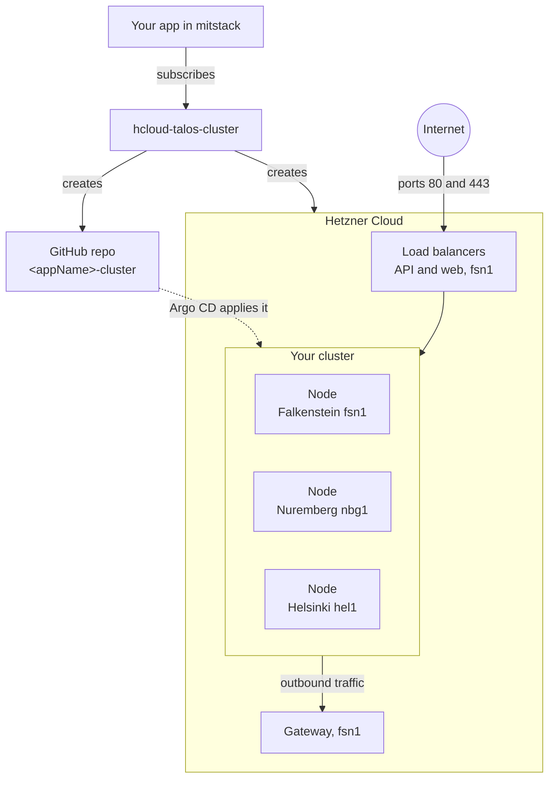
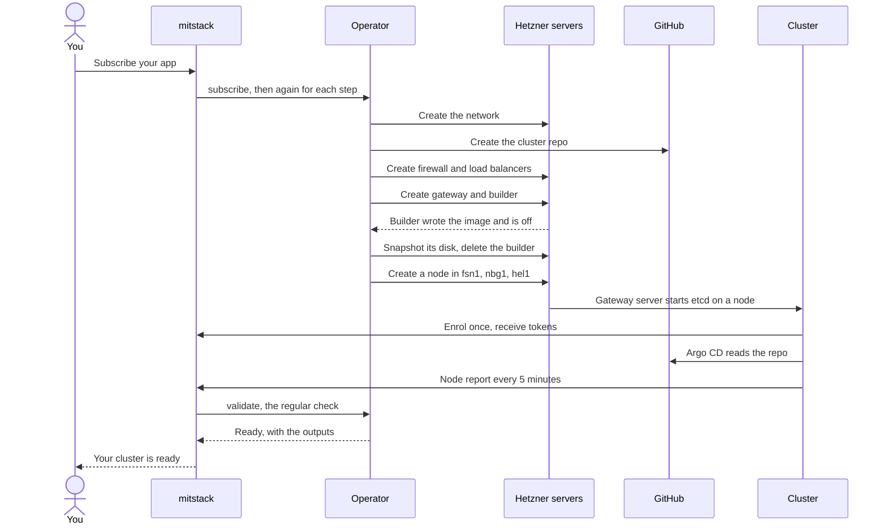

# hcloud-talos-cluster

Your app's own Kubernetes cluster on Hetzner Cloud, spread over three cities.

The cluster runs Talos Linux, an operating system made only for Kubernetes,
on one node each in Falkenstein, Nuremberg and Helsinki. Argo CD, a tool
inside the cluster, applies what you commit to a GitHub repo the block makes.
mitstack is a platform that runs ready-made services, called blocks, for your
apps. [The glossary](https://github.com/mitstack-eu/mitstack-workspace/blob/main/docs/glossary.md) defines its other words.



## At a glance

| You give it | You get |
|---|---|
| `appName`, your app's name | A three-node Kubernetes cluster for your app alone |
| `serverType`, the node size, `cx33` by default | `privateEndpoint`, the cluster's private API address |
| A Hetzner Cloud connection, for its API token | `publicIpByLocation`, the web traffic IP, under `fsn1` |
| A GitHub connection, for its token and owner | `clusterRepoUrl`, the private `<appName>-cluster` repo |

The block provides the type `hetzner.kubernetes-cluster` and needs no other
block. [Params, connections and outputs](docs/reference.md) has every table.

## Use it

1. In the mitstack console's [Capabilities page](https://api.mitstack.dev/capabilities),
   connect GitHub, and Hetzner with a Cloud project's read and write API token.
2. Subscribe your app to this block, and fill in `appName`.
3. Once the console shows the subscription ready, in up to 45 minutes, commit
   your Kubernetes manifests to the repo's `cluster/` folder.

## How it works

mitstack gives each request two minutes, and a cluster takes up to 45 minutes
to build. So the operator, the program in this repository, takes one step per
request, and mitstack keeps sending requests until the cluster is ready.

A short-lived builder server makes the disk image every node boots from. The
gateway, the only server with a public address, carries the nodes' outbound
traffic and starts etcd, the cluster's state store. The cluster then enrols:
it signs up with mitstack once and receives its tokens.



When you unsubscribe, the operator deletes every Hetzner resource it made, and
the repo too when it carries the two GitHub topics the block set on it.

## What's inside

```text
│   # Every block starts with these
├── manifest.yaml            what the block builds, provides and answers
├── main.go                  starts the web service: /hook, /logs, /healthz
├── resource.go              reads the params and takes each subscribe step
├── Dockerfile               builds the operator's container image
├── go.mod, go.sum           the Go module and its checksums
├── secrets_leak_test.go     proves no token reaches an answer or a log
├── teardown_test.go         proves unsubscribe deletes everything
├── .github/workflows/ci.yml tests the block and publishes its image
│   # This block adds these
├── LICENSE                  Business Source License 1.1
├── docs/                    the detail behind this page
├── hetzner.go               the Hetzner Cloud client
├── identity.go              the labels that tie resources to a subscription
├── state.go                 reads and sorts the subscription's resources
├── install.go               mints the keys, creates gateway and builder
├── userdata.go              start-up data for the builder and gateway
├── manifests.go             adds this block's manifests to the cluster
├── manifests/               Argo CD apps, enrolment Job, token renewal
├── scripts/                 shell scripts the servers run
├── repository.go            creates, reads and deletes the cluster repo
├── observe.go               reads each resource and sets the outputs
├── metrics.go               reads the builder's CPU and disk metrics
├── nodereports.go           reads the cluster's node reports
├── teardown.go              runs the unsubscribe
├── *_test.go                the rest of the tests, listed in docs/
└── testdata/                type snapshot and a default cluster's golden file
```

## Go deeper

- [Params, connections and outputs](docs/reference.md): every input and output, and when each appears.
- [How a subscribe runs](docs/how-a-subscribe-runs.md): what it builds, each step, and unsubscribe.
- [Build progress and failures](docs/build-progress-and-failures.md): what a build reports, and every refusal.
- [Inside the cluster](docs/inside-the-cluster.md): what runs there, the tools image and the logs.
- [Changing the block](docs/changing-the-block.md): running the tests, and what each file holds.
