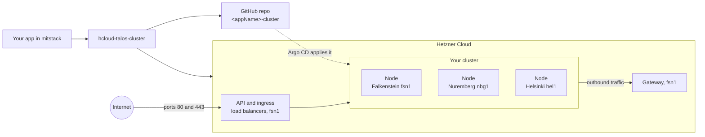
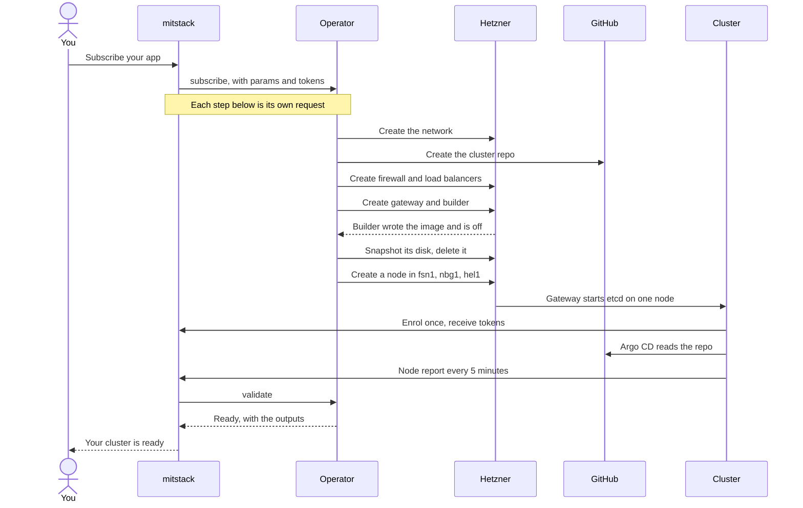

# hcloud-talos-cluster

Your app's own Kubernetes cluster on Hetzner Cloud, spread over three cities.

This page is for anyone new to mitstack who wants to use this block, or to see
how a block is made. Words like block, app and subscribe are defined in
[the workspace glossary](https://github.com/mitstack-eu/mitstack-workspace/blob/main/docs/glossary.md).



## At a glance

| You give it | You get |
|---|---|
| `appName`, your app's name | A three-node Kubernetes cluster for your app alone |
| `serverType`, the node size, `cx33` by default | `privateEndpoint`, the cluster's private API address |
| A Hetzner Cloud connection, for its API token | `publicIpByLocation`, the public IP for web traffic |
| A GitHub connection, for its token and owner | `clusterRepoUrl`, the private `<appName>-cluster` repo |

The block provides the type `hetzner.kubernetes-cluster` and needs no other
block. [Params, connections and outputs](docs/reference.md) has the full
tables.

## Use it

1. Link a Hetzner Cloud project and a GitHub account to your app in mitstack.
2. Subscribe your app to this block, and fill in `appName`.
3. Wait up to 45 minutes for the cluster to read ready. Then commit to the
   `cluster/` folder of `<appName>-cluster`, and Argo CD applies it.

## How it works

mitstack gives each request two minutes, and a cluster takes up to 45 minutes
to build. So the operator, the program in this repository, takes one step per
request, and mitstack sends the next request until the cluster is ready.



When you unsubscribe, the operator deletes every server, load balancer,
snapshot, firewall and network it made. Then it deletes the cluster repo, but
only when the repo carries this subscription's mark. mitstack counts the
unsubscribe done once every resource reads absent.

## What's inside

```text
hcloud-talos-cluster/
│   # Every block starts with these
├── manifest.yaml            what the block builds, provides and answers
├── main.go                  starts the web service: /hook, /logs, /healthz
├── resource.go              reads the params and takes each subscribe step
├── Dockerfile               builds the operator's container image
├── go.mod, go.sum           the Go module and its checksums
├── secrets_leak_test.go     proves no token reaches an answer or a log
├── teardown_test.go         proves unsubscribe deletes everything
├── .github/workflows/ci.yml tests the block and publishes its image
│   # This block adds these
├── README.md                this page
├── LICENSE                  Business Source License 1.1
├── docs/                    the detail behind this page
├── hetzner.go               the Hetzner Cloud client
├── identity.go              the labels that tie resources to a subscription
├── state.go                 reads and sorts the subscription's resources
├── install.go               mints the keys, creates gateway and builder
├── userdata.go              start-up data for the builder and gateway
├── manifests.go             adds this block's manifests to the cluster
├── manifests/               Argo CD apps, enrolment Job, token renewal
├── scripts/                 shell scripts the servers run
├── repository.go            creates, reads and deletes the cluster repo
├── observe.go               reads each resource and sets the outputs
├── metrics.go               reads the builder's CPU and disk metrics
├── nodereports.go           reads the cluster's node reports
├── teardown.go              runs the unsubscribe
├── *_test.go                the rest of the tests, listed in docs/
└── testdata/                type snapshot and a default cluster's golden file
```

## Go deeper

| Page | What it covers |
|---|---|
| [Params, connections and outputs](docs/reference.md) | Every param, connection, output and host setting, and when each output appears |
| [How a subscribe runs](docs/how-a-subscribe-runs.md) | What a subscribe builds, each step in order, and unsubscribe |
| [Build progress and failures](docs/build-progress-and-failures.md) | What a build reports while it runs, and every refusal |
| [Inside the cluster](docs/inside-the-cluster.md) | What runs in the cluster, the tools image and the logs |
| [Changing the block](docs/changing-the-block.md) | How to run the tests, and what each file holds |
